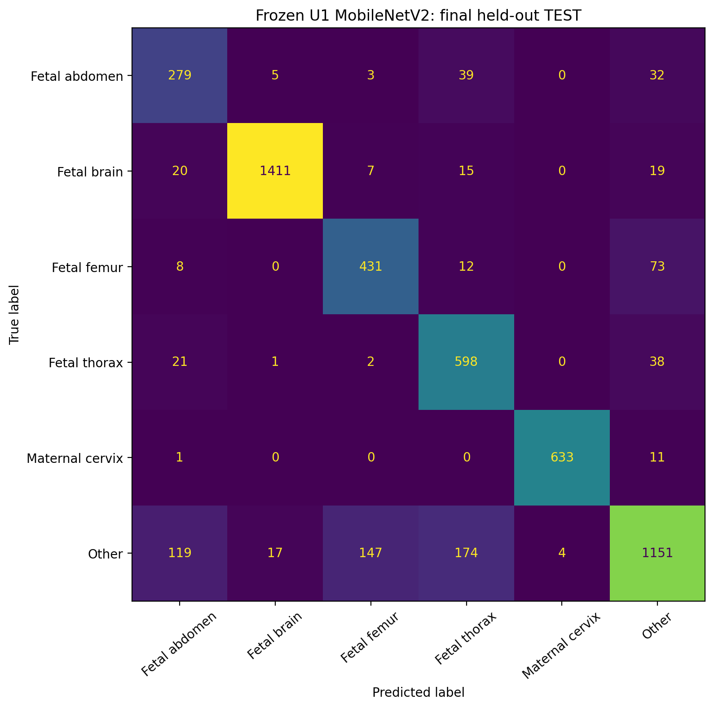
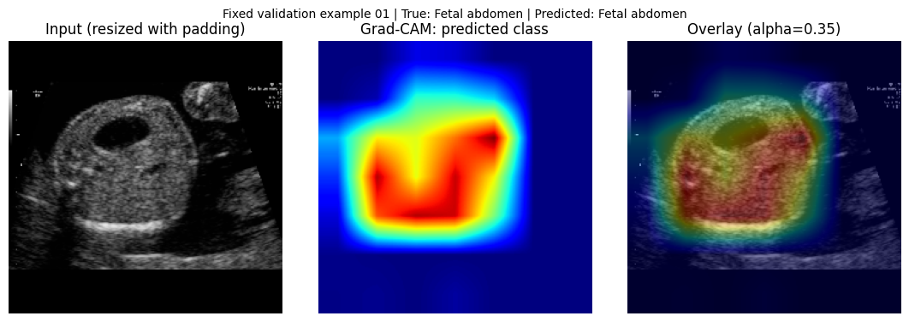
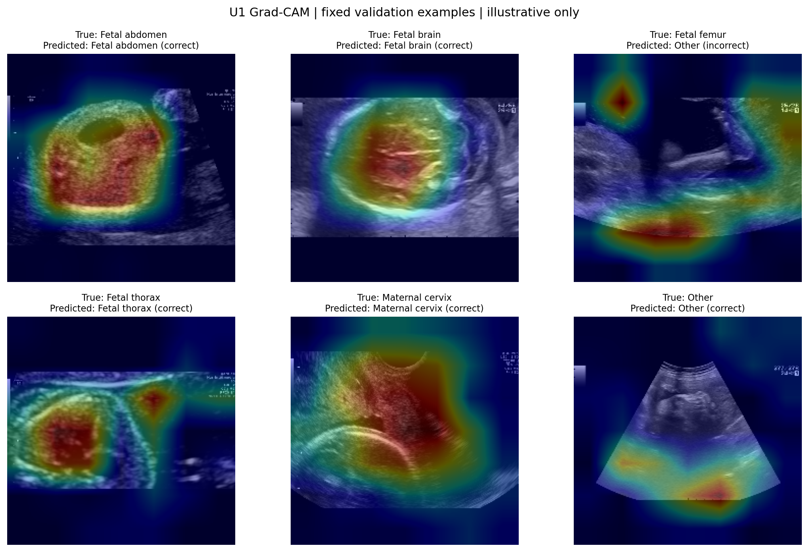

# Explainable Fetal Ultrasound Standard Plane Classification

[](https://www.python.org/)
[](https://tensorflow.org/)
[](https://keras.io/)
[](https://zenodo.org/record/3904280)
[]()
[]()

Undergraduate research project on classifying six anatomical categories of maternal-fetal ultrasound images using transfer learning and visual explainability (Grad-CAM).

**Author:** Kazi Nusrat Jahan Shithy  
**Supervisor:** Prof. Dr. Md. Zahidul Islam  
**Affiliation:** Department of Information and Communication Technology (ICT), Islamic University, Kushtia-7003, Bangladesh  
**Remote Repository:** [Shithy53/fetal-ultrasound-plane-classification](https://github.com/Shithy53/fetal-ultrasound-plane-classification)

---

> [!WARNING]
> **Medical and Educational Disclaimer:**  
> This project is designed strictly for academic, scientific, and educational research purposes. It implements automated standard-plane categorization, **not** clinical diagnosis or pathology detection. The models have not been certified or externally validated on multi-center clinical trials. Softmax predictions must not be interpreted as calibrated diagnostic probabilities or used for obstetric clinical triage.

---

## Table of Contents

- [Overview and Key Objectives](#overview-and-key-objectives)
- [Dataset and Partitioning Scheme](#dataset-and-partitioning-scheme)
  - [Six-Class Taxonomy](#six-class-taxonomy)
  - [Patient-Disjoint Partitions](#patient-disjoint-partitions)
  - [Class-by-Split Distribution](#class-by-split-distribution)
- [Methodology and Architecture](#methodology-and-architecture)
  - [Preprocessing Pipeline](#preprocessing-pipeline)
  - [Transfer Learning Models](#transfer-learning-models)
  - [Explainability with Grad-CAM](#explainability-with-grad-cam)
- [Experimental Results](#experimental-results)
  - [Model Selection Benchmark (Validation Split)](#model-selection-benchmark-validation-split)
  - [Final Held-Out Test Evaluation (U1 MobileNetV2)](#final-held-out-test-evaluation-u1-mobilenetv2)
  - [Per-Class Test Performance](#per-class-test-performance)
  - [Test Confusion Matrix](#test-confusion-matrix)
- [Explainability and Visual Findings](#explainability-and-visual-findings)
- [Repository Structure](#repository-structure)
- [Notebook Workflow and Reproducibility](#notebook-workflow-and-reproducibility)
  - [Environment Setup](#environment-setup)
  - [Notebook Directory Overview](#notebook-directory-overview)
  - [Cryptographic Verification Hashes](#cryptographic-verification-hashes)
- [Ethical Considerations and Limitations](#ethical-considerations-and-limitations)
- [Citation](#citation)

---

## Overview and Key Objectives

Fetal ultrasound examination during pregnancy is a critical routine procedure for monitoring fetal growth, detecting congenital abnormalities, and assessing gestational health. However, acquiring and verifying standard anatomical planes is heavily operator-dependent, requiring substantial clinical experience and time.

This project investigates an automated, explainable transfer-learning framework to classify maternal-fetal ultrasound images into six standard anatomical categories:

1. **Patient-Separated Rigor:** Eliminate data leakage by partitioning 12,400 ultrasound scans strictly by patient identifier (1,792 unique patient groups) across training, validation, and held-out test splits.
2. **Transfer Learning Backbones:** Compare frozen ImageNet-pretrained **MobileNetV2** and **EfficientNetB0** feature extractors under identical patient-separated conditions.
3. **Pre-Test Model Selection:** Formally select the superior architecture (MobileNetV2) based exclusively on validation metrics before ever exposing the held-out test split.
4. **Unbiased Generalization:** Evaluate the selected model once on a held-out test set of 5,271 images from 896 unseen patient groups.
5. **Model Interpretability:** Produce Gradient-weighted Class Activation Mapping (Grad-CAM) heatmaps across all six anatomical categories to analyze feature localization and failure modes.

---

## Dataset and Partitioning Scheme

The project utilizes the public **FETAL_PLANES_DB** ultrasound collection, comprising **12,400 images** across **1,792 unique patient groups**.

### Six-Class Taxonomy

| Class ID | Anatomical Plane | Description and Diagnostic Importance |
| :---: | :--- | :--- |
| **0** | **Fetal abdomen** | Transverse abdominal plane showing stomach bubble and umbilical vein; essential for abdominal circumference (AC) biometry. |
| **1** | **Fetal brain** | Transventricular or transthalamic axial views; crucial for biparietal diameter (BPD) and head circumference (HC). |
| **2** | **Fetal femur** | Longitudinal view of the femoral diaphysis; standard measurement plane for femur length (FL) growth assessment. |
| **3** | **Fetal thorax** | Four-chamber cardiac view and lung fields; fundamental for congenital heart defect screenings. |
| **4** | **Maternal cervix** | Sagittal view of the uterine cervix; critical for assessing preterm birth risk and cervical incompetence. |
| **5** | **Other** | Non-standard planes, fetal limbs, spine, placenta, amniotic fluid, or non-diagnostic acoustic windows. |

### Patient-Disjoint Partitions

To prevent overly optimistic performance caused by correlated images from the same subject, partitions were split at the **patient group level**. The official test partition was retained intact as the held-out test set:

| Partition | Total Images | Patient Groups | Percentage | Patient Leakage Audit |
| :--- | :---: | :---: | :---: | :---: |
| **Training** | 5,818 | 716 | 46.92% | **0 patients overlap** |
| **Validation** | 1,311 | 180 | 10.57% | **0 patients overlap** |
| **Held-Out Test** | 5,271 | 896 | 42.51% | **0 patients overlap** |
| **Total** | **12,400** | **1,792** | **100.0%** | **Audited (`results/audit.json`)** |

### Class-by-Split Distribution

The full class breakdown across the frozen partitions is documented in [results/class_counts.csv](results/class_counts.csv):

| Class Name | Training Split | Validation Split | Test Split | Total Images |
| :--- | :---: | :---: | :---: | :---: |
| **Fetal abdomen** | 282 | 71 | 358 | 711 |
| **Fetal brain** | 1,289 | 331 | 1,472 | 3,092 |
| **Fetal femur** | 404 | 112 | 524 | 1,040 |
| **Fetal thorax** | 828 | 230 | 660 | 1,718 |
| **Maternal cervix** | 765 | 216 | 645 | 1,626 |
| **Other** | 2,250 | 351 | 1,612 | 4,213 |
| **Total** | **5,818** | **1,311** | **5,271** | **12,400** |

The official partition manifest is preserved at [splits/manifest_candidate.csv](splits/manifest_candidate.csv) and the mapping at [splits/class_mapping.json](splits/class_mapping.json).

---

## Methodology and Architecture

```
Input Ultrasound Image
      │
      ▼
Resize with Aspect Ratio Preservation (224 × 224 × 3 with letterboxing/padding)
      │
      ▼
Input Scaling & Preprocessing
   ├── U1: MobileNetV2 scaling ([-1, 1] integrated in model)
   └── U2: EfficientNetB0 native scaling ([0, 255] normalized in model)
      │
      ▼
Frozen Pretrained Backbone (Feature Extraction)
   ├── U1: MobileNetV2 (ImageNet weights, frozen)  ──>  Extracts 'out_relu' for Grad-CAM
   └── U2: EfficientNetB0 (ImageNet weights, frozen)
      │
      ▼
GlobalAveragePooling2D
      │
      ▼
Dropout (0.2)
      │
      ▼
Dense Classification Head (6 units, Softmax activation)
      │
      ▼
Predicted Class Probability & Grad-CAM Explainability Heatmap
```

### Preprocessing Pipeline
- Images are resized to **224 × 224 pixels** with padding to preserve original anatomical aspect ratios without distortion.
- Data types are cast to `float32`.
- Data augmentation during training: random horizontal flips, mild rotation, and zoom.

### Transfer Learning Models
- **Experiment U1 (MobileNetV2):**
  - Frozen ImageNet backbone (`mobilenetv2_1.00_224`).
  - Internal preprocessing layer scaling pixels to `[-1, 1]`.
  - Target layer for Grad-CAM: `out_relu` (the final convolutional feature activation).
- **Experiment U2 (EfficientNetB0):**
  - Frozen ImageNet backbone (`efficientnetb0`).
  - Native internal preprocessing layer.

Both architectures were trained using:
- **Optimizer:** Adam ($\alpha = 10^{-3}$)
- **Loss:** Categorical Cross-Entropy
- **Batch Size:** 32
- **Callbacks:** EarlyStopping and ModelCheckpoint monitoring minimum validation loss.

---

## Experimental Results

### Model Selection Benchmark (Validation Split)

Both models were trained on the training partition (5,818 images) and benchmarked on the identical 1,311-image validation split:

| Metric | U1 (MobileNetV2 Baseline) | U2 (EfficientNetB0 Baseline) | Best Model |
| :--- | :---: | :---: | :---: |
| **Validation Accuracy** | **88.10%** | 86.88% | **U1 (+1.22%)** |
| **Validation Macro-F1** | **0.8572** | 0.8507 | **U1 (+0.0065)** |
| **Validation Macro-Precision** | **0.8468** | 0.8412 | **U1** |
| **Validation Macro-Recall** | **0.8718** | 0.8651 | **U1** |
| **Selected Epoch** | Epoch 2 | Epoch 5 | — |
| **Minimum Validation Loss** | 0.3552 | **0.3521** | U2 |
| **Total Parameters** | 2,265,670 | 4,057,254 | U1 (44% smaller) |

**Model Selection Decision:**  
**U1 MobileNetV2** was selected as the final model due to superior validation Macro-F1 (0.8572), higher accuracy (88.10%), significantly lower parameter count, and better recall on the heterogeneous `Other` category (0.7778 vs 0.6325). This decision was formally frozen before the held-out test set was evaluated.

---

### Final Held-Out Test Evaluation (U1 MobileNetV2)

The selected U1 checkpoint was evaluated **exactly once** on the **5,271 held-out test images** (from 896 disjoint patients). U2 was **not** evaluated on the test set to preserve scientific integrity.

| Overall Test Metric | Result |
| :--- | :---: |
| **Test Accuracy** | **85.4297% (4,503 / 5,271)** |
| **Test Macro-F1 Score** | **0.834528** |
| **Test Macro-Precision** | **0.818983** |
| **Test Macro-Recall** | **0.860314** |
| **Test Weighted-F1 Score** | **0.855734** |

### Per-Class Test Performance

Detailed breakdown from [results/U_Final_Test_U1_seed42/test_classification_report.csv](results/U_Final_Test_U1_seed42/test_classification_report.csv):

| Class Label | Precision | Recall | F1-Score | Support (Test Images) |
| :--- | :---: | :---: | :---: | :---: |
| **Fetal abdomen** | 0.6228 | 0.7793 | 0.6923 | 358 |
| **Fetal brain** | 0.9840 | 0.9586 | 0.9711 | 1,472 |
| **Fetal femur** | 0.7305 | 0.8225 | 0.7738 | 524 |
| **Fetal thorax** | 0.7136 | 0.9061 | 0.7984 | 660 |
| **Maternal cervix** | 0.9937 | 0.9814 | 0.9875 | 645 |
| **Other** | 0.8693 | 0.7140 | 0.7841 | 1,612 |
| **Macro Average** | **0.8190** | **0.8603** | **0.8345** | **5,271** |
| **Weighted Average** | **0.8665** | **0.8543** | **0.8557** | **5,271** |

Key observations:
- **Outstanding Discriminative Power:** Fetal Brain ($F_1 = 0.9711$) and Maternal Cervix ($F_1 = 0.9875$) achieve near-perfect classification due to distinctive cranial bones and endocervical canal morphology.
- **High Sensitivity:** Fetal Thorax achieved 90.61% recall, correctly capturing cardiac views.
- **Complex Background:** Fetal Abdomen ($F_1 = 0.6923$) presented the highest ambiguity due to subtle soft-tissue contrasts and stomach bubble variability against other abdominal views.

### Test Confusion Matrix

Below is the normalized confusion matrix across all 5,271 held-out test scans:



---

## Explainability and Visual Findings

Explainable AI (XAI) was implemented using **Grad-CAM (Gradient-weighted Class Activation Mapping)** targeting the penultimate convolutional layer (`out_relu`) of MobileNetV2.

- **Sample Selection:** 12 predefined validation images (2 per class, from 12 separate patient groups) were visualized to inspect anatomical attention.
- **Observation:** The model consistently attends to prominent anatomical landmarks, such as the cranial skull boundary for `Fetal brain`, the hyperechoic bone shaft for `Fetal femur`, and the cervical canal for `Maternal cervix`.

### Single Validation Example (Fetal Abdomen)



### Multi-Class Validation Overview Panel

The panel below displays Grad-CAM explanations across all six anatomical categories:



Individual Grad-CAM panel comparisons are accessible in [results/U_GradCAM_U1_validation_seed42/panels/](results/U_GradCAM_U1_validation_seed42/panels/).

---

## Repository Structure

```text
fetal-ultrasound-plane-classification/
├── README.md                                 # Comprehensive project documentation
├── requirements.txt                          # Exact environment dependencies
├── .gitignore                                # Excludes raw scans and large weights
│
├── docs/                                     # Research & provenance documentation
│   ├── DATASET_AND_SPLITS.md                 # Detailed split counts & patient hashes
│   ├── GRADCAM_IMAGE_PROVENANCE.md           # Attribution & export metadata for figures
│   ├── REPRODUCIBILITY.md                    # Environment details & execution records
│   └── RESULTS.md                            # Comprehensive experiment metrics
│
├── metadata/                                 # Official dataset metadata
│   └── FETAL_PLANES_DB_data.csv              # Full dataset image table & patient IDs
│
├── splits/                                   # Audited patient-level partitions
│   ├── class_mapping.json                    # Fixed class-to-index mapping dictionary
│   └── manifest_candidate.csv                # Complete partition assignments (12,400 rows)
│
├── notebooks/                                # Jupyter execution records
│   ├── 00_Ultrasound_Setup_and_Data_Checks.ipynb   # Split verification & data audit utility
│   ├── U1_Ultrasound_MobileNetV2_Baseline.ipynb    # Training & validation of MobileNetV2
│   ├── U2_Ultrasound_EfficientNetB0_Baseline.ipynb # Training & validation of EfficientNetB0
│   ├── U_GradCAM_U1_MobileNetV2.ipynb              # Grad-CAM heatmap generation pipeline
│   └── U_Final_Test_U1_MobileNetV2.ipynb           # One-time final held-out test evaluation
│
└── results/                                  # Complete experimental artifacts & reports
    ├── audit.json                            # Automated partition audit validation report
    ├── class_counts.csv                      # Class distribution per split summary
    ├── figures/                              # Standalone publication-ready figures
    │   └── U1_GradCAM_validation_example_01.png
    ├── training_previews/                    # Pre-training sample ultrasound previews
    ├── U1_MobileNetV2_frozen_seed42/         # U1 training loss curves & validation metrics
    ├── U2_EfficientNetB0_frozen_seed42/      # U2 training curves, validation & comparison
    ├── U_GradCAM_U1_validation_seed42/       # Grad-CAM panels (12 examples) & overview figure
    └── U_Final_Test_U1_seed42/               # Final held-out test metrics, report & matrix
```

---

## Notebook Workflow and Reproducibility

### Environment Setup

Clone the repository and install the dependencies in a clean virtual environment:

```bash
# Clone the repository
git clone https://github.com/Shithy53/fetal-ultrasound-plane-classification.git
cd fetal-ultrasound-plane-classification

# Create and activate virtual environment
python3 -m venv .venv
source .venv/bin/activate   # On Windows: .venv\Scripts\activate

# Install required packages
pip install --upgrade pip
pip install -r requirements.txt
```

### Notebook Directory Overview

The notebooks under `notebooks/` preserve the historical Google Colab execution records:

| Notebook | Purpose | Saved Output Cells |
| :--- | :--- | :---: |
| [`00_Ultrasound_Setup_and_Data_Checks.ipynb`](notebooks/00_Ultrasound_Setup_and_Data_Checks.ipynb) | Dataset recovery, directory creation, and manifest verification. | 0/6 (Utility) |
| [`U1_Ultrasound_MobileNetV2_Baseline.ipynb`](notebooks/U1_Ultrasound_MobileNetV2_Baseline.ipynb) | Trains frozen MobileNetV2, generates loss curves, evaluates validation set. | 7/7 (Executed) |
| [`U2_Ultrasound_EfficientNetB0_Baseline.ipynb`](notebooks/U2_Ultrasound_EfficientNetB0_Baseline.ipynb) | Trains frozen EfficientNetB0, evaluates validation set, generates comparison. | 10/10 (Executed) |
| [`U_GradCAM_U1_MobileNetV2.ipynb`](notebooks/U_GradCAM_U1_MobileNetV2.ipynb) | Generates Grad-CAM activation overlays on 12 preselected validation scans. | 8/8 (Executed) |
| [`U_Final_Test_U1_MobileNetV2.ipynb`](notebooks/U_Final_Test_U1_MobileNetV2.ipynb) | Executes one-time final test evaluation on the 5,271 held-out test scans. | 8/8 (Executed) |

> [!NOTE]
> The executed notebooks reference `/content/drive/MyDrive/ICTIU_Final_Projects/ultrasound/` where the large raw scans and model checkpoints (`best_model.keras`) were persisted during Colab runs.

### Cryptographic Verification Hashes

To verify the integrity of the data partitions and historical runs, verify the following SHA-256 checksums:

| File / Component | SHA-256 Checksum |
| :--- | :--- |
| `splits/manifest_candidate.csv` | `ef6fec1a70e80a0b7ed34c990ebac2918ddc8a81dcef300aa244ce6ab1a5e1e0` |
| `splits/class_mapping.json` | `26ec8f0a94d29d3756f36c52f02ddaad0d953403c0cd3d3903a243547d693428` |
| U1 Checkpoint (`best_model.keras`) | `5154c6d97685c2ef39d3ba040a409443cc0f261e070ca627c24b940979b897ae` |
| `U1_Ultrasound_MobileNetV2_Baseline.ipynb` | `4d6803aa71dcd922ba9d2216ec55d3615457561bedbc70c50ddefcebf595457c` |
| `U2_Ultrasound_EfficientNetB0_Baseline.ipynb` | `e6fcadd1a08341372710a0f3bc18cd4444d56b63527acf7d1a5027661d24334a` |
| `U_GradCAM_U1_MobileNetV2.ipynb` | `be3fd19fc6d6ef70f9b80bfdc55b7d4faa90c4d67057e55b68afd2cf72af5ac5` |
| `U_Final_Test_U1_MobileNetV2.ipynb` | `e691872a44ec4ae83a0f22fa93edce3c27353e60f76e538db84b8f2a6eb49f10` |

---

## Ethical Considerations and Limitations

1. **Dataset Origin:** Derived from a single geographic medical cohort ([FETAL_PLANES_DB, Zenodo](https://zenodo.org/record/3904280)). Generalization across external hospital ultrasound systems (e.g., GE, Philips, Siemens, Mindray) requires multi-center validation.
2. **Acoustic Artifacts:** Ultrasound quality depends heavily on maternal body mass index (BMI), gestational age, fetal motion, and acoustic shadowing from fetal bones.
3. **Interpretability Constraints:** Grad-CAM heatmaps highlight feature attribution in the neural network; they do not represent anatomical segmentations or diagnostic proof.

---

## Citation

If you use or reference this work in your research, please cite:

```bibtex
@misc{shithy2026fetalultrasound,
  author       = {Kazi Nusrat Jahan Shithy, S M Sajjad Hossain Soykot and Md. Zahidul Islam},
  title        = {Explainable Fetal Ultrasound Standard Plane Classification Using Transfer Learning and Grad-CAM},
  year         = {2026},
  publisher    = {GitHub},
  howpublished = {\url{https://github.com/Shithy53/fetal-ultrasound-plane-classification}},
  note         = {Undergraduate Research Project, Dept. of Information and Communication Technology, Islamic University, Bangladesh}
}
```

---

<p align="center">
  <b>Department of Information and Communication Technology</b><br>
  Islamic University, Kushtia-7003, Bangladesh
</p>
